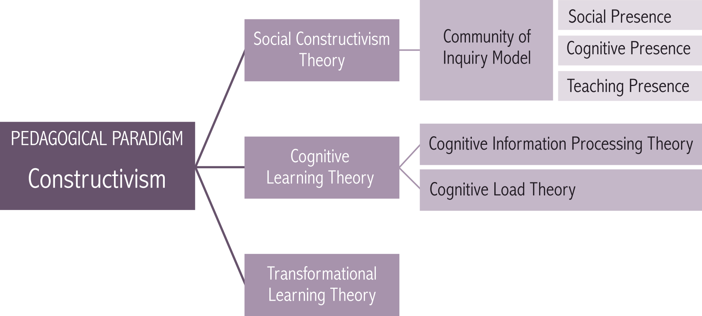

## A Constructivist-based Proposal for Bioinformatics Teaching Practices During Lock-down

Cristóbal Gallardo-Alba1, Björn Grüning2* and Beatriz Serrano-Solano2* 
1 unaffiliated
2 Bioinformatics Group, Department of Computer Science, Albert-Ludwigs-University Freiburg, Georges-Köhler-Allee 106, Freiburg 79110, Germany

### Abstract

The COVID-19 outbreaks have caused universities all across the globe to close their campuses and forced them to initiate online teaching. This article reviews the pedagogical foundations for developing effective distance bioinformatics education practices, starting from the assumption that promoting autonomous thinking is an essential element to guarantee full citizenship in a democracy and for moral decision making in situations of rapid change, which has become a pressing need in the current context. In addition, the main obstacles related to this new context are identified, and solutions are proposed according to the existing bibliography in learning sciences. 

KEYWORDS: constructivism, e-learning, online teaching, social constructivism theory, cognitive learning theory, transformative learning theory
Introduction

### Introduction

Universities across the globe are struggling to set up the technical systems needed to move courses, exams, research and other activities online due to the COVID-19 pandemic. In the words of Carol McQuiggan, former Director of the Faculty Center for Teaching and Instructional Technology at Penn State Harrisburg, ‘what worked for them in the past in their traditional classroom may no longer be helpful or reliable in the distance education context’ [1].

Qualitative research into online learning suggests that students experience greater dissatisfaction, interpersonal isolation, feelings of unclear direction and uncertainty, and a lack of engagement in this environment [2] [3] [4] [5]. Despite not  being associated with a single cause, research indicates that a crucial mistake is to perceive technology only as a channel for transferring content, used as a substitute for other tools, ignoring the growing knowledge about pedagogical practices in online education [6] [7].

The results of several studies indicate that the constructivist learning theory is the most appropriate to exploit the potential of technology-mediated educational practice, an intrinsic feature of distance education. [11a]. Due to its nature, it requires to move beyond traditional models into new practices more focused on the collective construction of knowledge rather than simply on the delivery of content [10]. 

This paper summarizes the pedagogical foundations necessary to develop quality distance bioinformatics education practices, according to the existing bibliography. In addition, it seeks to help trainers organize their computational biology lessons by establishing the theoretical basis for our recommendations on online teaching described in Serrano-Solano et al. [8].

### A constructivist approach to bioinformatics education

Constructivism roots have their origin in the work of the Swiss psychologist Jean Piaget. Its core idea is that knowledge acquisition is a dynamic process which must be led by the learner through experience, discussion and reflection [11] [12]. It assumes that students learn better when they control the pace of learning, giving a special value to learning experiences which involve real-life problems [15] [16] [17].

According to this paradigm, students, far from being passive recipients of information, must act as the active protagonist of the learning process [13].  For this reason, curruclumns should be structured in a spiral manner, so that the new knowledge should be rooted on previous learning.

Although the constructivist theory has profoundly influenced the teaching of science and mathematics, its applicability to bioinformatics has received much less attention, probably due to its cross-disciplinary nature. Bioinformatics education can be defined as the application of computational methods to collect, store, interpret, and integrate data in order to solve biological problems [8a] [8b].

According Magana et al. (2014), bioinformatics education is divided in four dimensions: conceptual, methodological, computational tools and information resources [8c]. Computational tools includes the knowledge of pre-existing instruments and applications, and the ability to use them to solve biological problems. Finally, the information resources category includes knowledge of available databases and information sources.

In addition to these categories, in the context of distance education it is necessary to pay special attention to the social dimension, which in spite of not being proper of the education in bioinformatics, is essential to solve some of the problems linked to the distance education.
 
#### Conceptual dimension

The conceptual dimention refers to how to teach the abstract ideas or general notions that any student must know and understand in order to solve certain problems. 

According the constructivist paradigm, the adquisiton of new knowledge is a recursive process in which new concepts are built on previos ones the learning process of highly abstract concept is not possible if there is no previous conceptual foundation [13a] [13b]. It explains that one of the first challenges facing bioinformatics students is the lack of mental models of basic elementary computer science concepts, which usually leads to frustation. It is the responsability of the teacher to establish the conceptual foundation on which students can develop their learning process autonomously [8d].

Diverse authors agree that, in order to implement adequate online teaching practices, it is necessary to take into account the characteristics of mental processes [30] [6]. Cognitive learning theory aims to describe the links between cognitive structures, defined as the mental representations of objects or ideas, and the learning process [31][32]. Experimental results have shown that cognitive learning styles affects the adquisition of mental models [9a] [9b]. Thus, students with an abstract learning mode tend to identify more easly the patterns inherent in an abstract model, whereas concrete learners prefers metaphors or analogies to facilitate learning new conceptual structures [9c] [9d].

The distance education can make difficult the identification of the learning styles of the students. For that reason it is essential that the educational resources include diverse formats to address differences in learning styles and learning paces.

### Metodological dimension

The methodological dimensions refers to analysis, design, implementation and evaluation of computational processes, such as algorithm design. The set of skills needed in the field of bioinformatics, such as the capacity for multi-level abstraction, algorithmic thinking or reduction and decomposition in solving complex problems, requires that students with a biological background adopt a set of metacognitive habits known as computational thinking [9f]. It can be defined as the hability of recognizing computational aspects in natural processs which configure our reality, and apply the tools and techniques of computing to understand and model them.

### Computational tools and information resources dimensions

### Social dimension

An important component of learning is the social interaction between participants. Online learning requires adjustments by instructors as well as students for successful interactions to occur.  

According to the social constructivism theory, the knowledge construction process takes place more efficiently in a social context, where ideas can be shared and challenged [18] [19]. This is in harmony with research by Palloff and Pratt, which points out that establishing a learning community is essential for implementing online learning practices successfully [20].

The flexibility offered by online learning is one of the key aspects to consider the constructivist theory as especially suitable for this context since 

#### Social Constructivism Theory

The community of inquiry model [21] describes the online educational experience in a learning community as arising from the interaction of three elements: teaching presence, cognitive presence and social presence.

As stated by Garrison et al. teaching presence involves design and administration, discourse facilitation, and direct instruction [21]. Design and administration involve precision and transparency in planning instruction, discourse facilitation requires effort on the part of the instructor to maintain active learning, while direct instruction focuses on intellectual and scholarly leadership [9]. 

Cognitive presence can be operationally defined as a cyclical process consisting of four steps: problem identification, collective exploration through critical reflection and discourse, knowledge construction from the previously confronted ideas, and integration of the newly gained knowledge through its practical implementation [22]. Teaching presence is considered essential in order to prevent the interruption of the processes during the initial phase, thus allowing more advanced stages of critical thinking and cognitive development [23].

Social presence - defined as the competence to transmit the feeling of closer social contacts in a certain communicative context - is considered an essential factor for establishing functional learning communities [24] [25]. According to this construct, the potential of certain communication technology to transmit social presence is directly proportional to its ability to transmit non-verbal information [26]. Research indicates that adequate social presence is intimately related to both students’ perception of the learning process and their engagement [27] [28].

It is considered that despite cognitive and social presences being indispensable factors for achieving higher levels of learning, the success of educational practices depends on the instructor capacity to properly structure the interactions in the community through an adequate design of the learning process [29].

#### Cognitive Learning Theory

 Two important theories derive from this one: information processing theory and cognitive load theory.

The information processing theory describes learning as the result of sequential processing of information, which involve three types of memory: immediate memory, working memory and long term memory [33]. According to this theory, adequate learning resources require to assume two key elements: firstly, the fact that working memory is limited; and secondly, that the interaction between working and long term memory plays an important role in the construction and transferability of knowledge [6] [13] [34].

On the other hand, cognitive load theory seeks specifically to address the efficiency with which information is processed. It states that the verbal and visual information is processed by independent cognitive structures, both of them with a limited capacity [35] [36] [37] [38] [39]. An interesting concept derived from this theory is the cognitive overload, which refers to those situations in which the information flow exceeds the learner’s processing capacity, resulting in an inhibition of the learning process [40] [41].

#### Transformative Learning Theory

Transformative learning theory [42] aims to define the mechanisms involved in the development of critical thinking during the learning process. According to Richard Paul, ‘the traits of critical thinkers include independent thinking, intellectual empathy, intellectual humility, courage, integrity, perseverance, intellectual curiosity, faith in reason, intellectual civility, and intellectual responsibility’ [43].

Transformative learning occurs when the learning process induces a shift in the student's frame of reference [42] [44], e.g. the role assigned to science by the students, their self-concept and role in society, etc. Although this goal can be achieved in multiple ways, a successful strategy is to stimulate reflection on uncritically accepted assumptions, such as those derived from cultural assimilation, through the exchange of points of view within a learning community [42] [45] [46]. It is the educator responsibility to cultivate students’ skills related to autonomous thinking by designing activities for that purpose [43].

### Major online-learning challenges

As claimed by Goolam Mohamedbhai, member of the governing council of the United Nations University, ‘it is a fallacy to believe that online learning can be effective by merely posting a lecturer’s notes online or having a video recording of the lecture’ [47]. In addition, the performance of the learning community can be affected if the majority of the members do not manage to adapt to the online context [48]. Therefore, it is important to carefully analyze the e-learning’ problematic dimensions.

#### Teaching effectiveness in technology-mediated learning

Technological tools, due to their design, do not act just as neutral means for transmitting information, but they also transmit values ​​and habits of thought [49] [50]. Thus, for example, when teaching is dominated by one-way media, hierarchical relationships are promoted, which entails an attack on critical thinking [51]. 

When considering video-records as teaching tools, it is important to incorporate those auxiliary technologies which could increase their pedagogical potential, such as including short-quizzes [17]. Those strategies can result in improved teaching and social presence, which in turn are linked to an increase in the students’ engagement.

Communication is crucial for assessment but a critical point to take into account when selecting the tools is that synchronous and asynchronous ones should be used for different educational purposes in online courses. Research indicates that synchronous discussions are more useful for fostering social presence, while asynchronous communication for developing higher levels of thinking [52] [29].

#### Teacher's role in online teaching

Web-based environments require deep cultural shifts, such as sharing control of the learning process, which can result in a loss of teacher’s professional identity [53] [54] [55] [56]. In addition, the teacher’s role as a learning facilitator is usually linked to higher levels of stress [57].

Results indicate that, in a video-conferencing environment, an instructor’s positive attitude towards technology, interactive teaching style, and control over the technology, are related to perceived learning effectiveness, with teaching style showing the most important influence on student involvement and participation [58].  Teachers who are skilled at community building are considered particularly valuable [59].

On the other hand, qualitative data suggest that students place a high priority on the instructor’s ability to establish and maintain an engaging and constructive discussion environment [60]. In addition, carefully planned interactive activities lead both to greater learning and enhanced motivation [61] [62].
 
#### Student engagement in online environments

Online learning puts special demands on students to stay motivated and focused [63] [64]. For this reason, instructors must consciously supply this need with a combination of motivational techniques.

Firstly, as in classroom teaching, intrinsic motivation is key. To boost it, instructors need to understand each student’s short and long-term personal learning goals and then design activities that resonate with them, if possible by using real-life problems [63] [65].

Another motivational technique which has been suggested as extremely useful consists of fostering learner’ self-directed learning pace [65]. To this end, it is essential to establish a cooperative environment in which students were able to self-organize the learning process, starting from certain guidelines provided by the instructor, who should act as a facilitator rather than as an authority on the subject [42] [67] [68] [69].

Finally, a third motivational technique considered useful for improving teaching effectiveness and student engagement is the design of learner-centred syllabus, characterized by shared decision-making and structured and clear objectives [70] [71].

#### Creating an effective learning community

Establishing a functional learning community has been proved to be a key factor for overcoming some of the major drawbacks linked to distance education, such as the student’s feeling of isolation and their lack of motivation and interaction [72] [73] [74].

It’s the instructor’s responsibility to stimulate the creation and maintenance of a structured network of reciprocal interactions between students that enables the collective construction of knowledge efficiently [75]. Research results indicate that students who are appropriately integrated into learning communities obtain higher grades [76]. In addition, quantitative results suggest a relationship between interaction levels and group size, and that group size is a critical factor to the effectiveness of learning [77] [78].
Conclusion

The COVID-19 pandemic is probably going to entail a turning point for the global educational system. The profound cultural changes imposed by the general situation of uncertainty are going to force the previous teaching practices to adapt to this new context.

We consider that, in order to collectively face the challenges associated with the current situation, it is necessary to establish a conceptual framework shared by the whole educational system and capable of offering the necessary tools to uphold the quality of the educational practices. 

Our proposal relies on a fundamental pillar: the constructivist paradigm as the philosophy of learning, that is, to consider the promotion of autonomous thinking as an essential element to guarantee full citizenship in a democracy and for moral decision making in situations of rapid change. From this starting point, we consider that three main theories must be deployed: the social constructivism theory, the cognitive learning theory and the transformative learning theory. 

Assuming this theoretical foundation, it is possible to overcome the main caveats of distance education - such as the student’s feeling of isolation or the teacher's ability to maintain their engagement in online environments - by paying special attention to the roles of technology, teaching practices, learning communities, motivation, and the way these elements interact with each other.

## TOP TIPS FOR INSTRUCTORS

• Make the learning process active and dynamic: let students experience rather than be passive learners by boosting discussion and reflection.
• Keep the motivation up: use real-life problems, understand each student’s short and long-term personal learning goals.
• Be clear: give direct instructions in a precise and transparent way. 
• Be flexible: let students control the pace of learning starting from certain guidelines, allow them to self-organize the learning process.
• Avoid hierarchical media: bidirectional communication promotes critical thinking.
• Use synchronous channels to foster social presence.
• Use asynchronous channels for higher levels of thinking.
• Build a community: be close, create a cooperative environment that encourages constructive discussion, share and challenge ideas to promote social interaction.
• Read the paper by Serrano-Solano et al. for technical advice on how to implement our recommendations easily.

#### Acknowledgement

We would like to thank the Galaxy community and Dr. Jean-Karim Hériché for his valuable comments and improvements on this manuscript.

### References

[1] McQuiggan, C. A. (2007). The role of faculty development in online teaching’s potential to question teaching beliefs and assumptions. Online Journal of Distance Learning Administration, 10(3), 1-13.

[2] Bambara, C. S., Harbour, C. P., Davies, T. G., & Athey, S. (2009). Delicate engagement: The lived experience of community college students enrolled in high-risk online courses. Community College Review, 36(3), 219-238

[3] Hara, N., & Kling, R. (1999). Students' frustrations with a web-based distance education course. Retrieved from: https://firstmonday.org/ojs/index.php/fm/%20article/view/710/620

[4] Jaggars, S. S. (2014). Choosing between online and face-to-face courses: Community college student voices. American Journal of Distance Education, 28(1), 27-38

[5] Xu, D., & Jaggars, S. S. (2014). Performance gaps between online and face-to-face courses: Differences across types of students and academic subject areas. The Journal of Higher Education, 85(5), 633-659.

[6] Chandler, P. (2004). The crucial role of cognitive processes in the design of dynamic visualizations. Learning and Instruction, 14(3), 353-357.

[7] Herrington, J., & Kervin, L. (2007). Authentic learning supported by technology: Ten suggestions and cases of integration in classrooms. Educational Media International, 44(3), 219-236.

[8] Serrano-Solano, B., Fostering Accessible Online Education Using Galaxy as an e-learning Platform, BiorXiv.

[8] Anderson, T., Liam, R., Garrison, D. R., & Archer, W. (2001). Assessing teaching presence in a computer conferencing context. JALN Volume 5, Issue 2.

[8a] Counsell D (2003). A review of bioinformatics education in the UK. Brief Bioinform 4, 7–21.

[8b] Koch I, Fuellen G (2008). A review of bioinformatics education in Germany. Brief Bioinform 9, 232–242.

[8c] Magana, A. J., Taleyarkhan, M., Alvarado, D. R., Kane, M., Springer, J., & Clase, K. (2014). A Survey of Scholarly Literature Describing the Field of Bioinformatics Education and Bioinformatics Educational. 13, 607–623.

[8d] Wu, C. C., Dale, N. B., & Bethel, L. J. (1998). Conceptual models and cognitive learning styles in teaching recursion. Poceedings of the Conference on Integrating Technology into Computer Science Education, ITiCSE, 292–296.

[9] Palloff, R. M., & Pratt, K. (2002). Lessons from the cyberspace classroom: The realities of online teaching. John Wiley & Sons.

[9a] Norman, D. A. Some observation of mental models. In D. Gentner and A.L. Stevens (Eds.), Mental Models (pp. 7-14). Erlbaum, Hillsdale, NJ, 1983.

[9b] Van der Veer, G. C. and Felt, M. A. M. Development of mental models of anoffrce system: A field study on an introductory course. In G.C. van der Veer & G. Mulder @Us.), Human-Computer I Interaction: Psychonomic Aspects (pp. 251-272). Springer-Verlag, New York, 1988

[9c] Wu, C. C., Dale, N. B., & Bethel, L. J. (1998). Conceptual models and cognitive learning styles in teaching recursion. Poceedings of the Conference on Integrating Technology into Computer Science Education, ITiCSE, 292–296.

[9d] Forišek, M., & Steinová, M. (2012, February). Metaphors and analogies for teaching algorithms. In Proceedings of the 43rd ACM technical symposium on Computer Science Education (pp. 15-20).

[9f] Qin, H. (2009, March). Teaching computational thinking through bioinformatics to biology students. In Proceedings of the 40th ACM technical symposium on Computer science education (pp. 188-191).

[10] Gilakjani, A. P., Lai-Mei, L., & Ismail, H. N. (2013). Teachers' use of technology and constructivism. International Journal of Modern Education and Computer Science, 5(4), 49

[11a] Pourhosein Gilakjani, A., Mei Leong, L., & Nizam Ismail, H. (2013). Teachers’ Use of Technology and Constructivism. International Journal of Modern Education and Computer Science, 5(4), 49–63.

[11] Honebein, P. C. (1996). Seven goals for the design of constructivist learning environments. Constructivist learning environments: Case studies in instructional design, 11-24.

[12] Zhang, D., Zhou, L., Briggs, R. O., & Nunamaker Jr, J. F. (2006). Instructional video in e-learning: Assessing the impact of interactive video on learning effectiveness. Information & management, 43(1), 15-27.

[13] Brooks, J. G., & Brooks, M. G. (1999). In search of understanding: The case for constructivist classrooms. ASCD.

[13a] Bruner, J. S. (1966). Toward a theory of instruction (Vol. 59). Harvard University Press.

[13b] Chesnevar, C. I., Maguitman, A. G., González, M. P., & Cobo, M. L. (2004). Teaching fundamentals of computing theory: A constructivist approach. Journal of Computer Science and Technology, 4(2), 91–97.

[14] Leidner, D. E., & Jarvenpaa, S. L. (1995). The use of information technology to enhance management school education: A theoretical view. MIS quarterly, 265-291.

[15] Huang, H. M. (2002). Toward constructivism for adult learners in online learning environments. British journal of educational technology, 33(1), 27-37

[16] Liaw, S. S. (2004). Considerations for developing constructivist web-based learning. International Journal of Instructional Media, 31, 309-319.

[17] Vygotsky, L. S. (1962). Thought and language, trans. E. Hanfmann & G. Vakar. Cambridge, MA: Massachusetts Institute of Technology

[18] Bates, T. (2015). Teaching in a digital age: Guidelines for designing teaching and learning for a digital age. Tony Bates 
Associates.

[19] Palloff, R. M., & Pratt, K. (2007). Building online learning communities: Effective strategies for the virtual classroom. John Wiley & Sons.

[20] Garrison, D. R., Anderson, T., & Archer, W. (1999). Critical inquiry in a text-based environment: Computer conferencing in higher education. The internet and higher education, 2(2-3), 87-105.

[21] Garrison, D. R., Anderson, T., & Archer, W. (2001). Critical thinking and computer conferencing: A model and tool to assess cognitive presence.

[22] Gorsky, P., & Blau, I. (2009). Online teaching effectiveness: A tale of two instructors. The International Review of Research in Open and Distributed Learning, 10(3).

[23] De Gagne, J. C., & Walters, K. (2009). Online teaching experience: A qualitative metasynthesis (QMS). MERLOT Journal of Online Learning and Teaching, 5(4).

[24] Tu, C. H. (2002). The measurement of social presence in an online learning environment. International Journal on E-learning, 1(2), 34-45.

[25] Kendall, K. E. (1999).Emerging information technology: Improving decisions, cooperation, and infrastructure. Sage.

[26] Richardson, J., & Swan, K. (2003). Examining social presence in online courses in relation to students' perceived learning and satisfaction.

[27] Swan, K., & Shih, L. F. (2005). On the nature and development of social presence in online course discussions. Journal of Asynchronous learning networks, 9(3), 115-136.

[28] Kanuka, H., & Garrison, D. R. (2004). Cognitive presence in online learning. Journal of Computing in Higher Education, 15(2), 21.

[29] Tobin, K. (1987). The role of wait time in higher cognitive level learning. Review of educational research, 57(1), 69-95.

[30] Yilmaz, K. (2011). The cognitive perspective on learning: Its theoretical underpinnings and implications for classroom practices. The Clearing House: A Journal of Educational Strategies, Issues and Ideas, 84(5), 204-212.

[31] Sedikides, C., & Skowronski, J. J. (1991). The law of cognitive structure activation. Psychological Inquiry, 2(2), 169-184.

[32] Feigenbaum, E. A. (1970). Information processing and memory. Models of human memory, 451-468.

[33] Cowan, N. (2010). The magical mystery four: How is working memory capacity limited, and why?. Current directions in psychological science, 19(1), 51-57.

[34] Bradford, G. R. (2011). A relationship study of student satisfaction with learning online and cognitive load: Initial results. The Internet and Higher Education, 14(4), 217-226.

[35] Paivio, A. (1990). Mental representations: A dual coding approach (Vol. 9). Oxford University Press.

[36] Miller, G. A. (1956). The magical number seven, plus or minus two: Some limits on our capacity for processing information. Psychological review, 63(2), 81.

[37] Baddeley, A. D. (2002). Is working memory still working?. European psychologist, 7(2), 85.

[38] Paas, F., Renkl, A., & Sweller, J. (2004). Cognitive load theory: Instructional implications of the interaction between information structures and cognitive architecture. Instructional science, 32(1/2), 1-8.

[39] Sweller, J., Van Merrienboer, J. J., & Paas, F. G. (1998). Cognitive architecture and instructional design. Educational psychology review, 10(3), 251-296.

[40] Clark, R. E. (1999). Yin and yang cognitive motivational processes operating in multimedia learning environments. Cognition and multimedia design, 73-107.

[41] Mezirow, J. (1997). Transformative learning: Theory to practice. New directions for adult and continuing education, 1997(74), 5-12.

[42] Paul, R. W. (1995). Critical thinking: How to prepare students for a rapidly changing world. Santa Rosa. In CA: Library of Congress.

[43] Merriam, S. B., & Baumgartner, L. M. (2020). Learning in adulthood: A comprehensive guide. John Wiley & Sons.

[44] Boyer, N. R., Maher, P. A., & Kirkman, S. (2006). Transformative learning in online settings: The use of self-direction, metacognition, and collaborative learning. Journal of Transformative Education, 4(4), 335-361.

[45] Barraclough, L., & McMahon, M. R. (2013). US-Mexico border studies online collaboration: Transformative learning across power and privilege. Equity & Excellence in Education, 46(2), 236-251

[46] Mohamedbhai, Goolam. “COVID-19: What Consequences for Higher Education?” University World News, 9 Apr. 2020, www.universityworldnews.com/post.php?story=20200407064850279.

[47] Xu, D., & Jaggars, S. (2013). Adaptability to online learning: Differences across types of students and academic subject areas. Community College Research Center, Teachers College, Columbia University. New York.

[48] Murphy, J. W. (1986). Humanizing the use of technology in education: A re-examination. International Review of Education, 32(2), 137-148.

[49] Anders, G. (1980). The Obsolescence of Man, Volume II: On the Destruction of Life in the Epoch of the Third Industrial Revolution.

[50] Giroux, H. A., Freire, P., & McLaren, P. (1988). Teachers as intellectuals: Toward a critical pedagogy of learning. Greenwood Publishing Group.

[51] Im, Y., & Lee, O. (2003). Pedagogical implications of online discussion for preservice teacher training. Journal of research on technology in education, 36(2), 155-170.

[52] Jaffee, D. (2003). Virtual transformation: Web-based technology and pedagogical change. Teaching Sociology, 31(2), 227-236.

[53] Diekelmann, N., Schuster, R., & Nosek, C. (1998). Creating new pedagogies at the millennium: The common experiences of University of Wisconsin-Madison teachers using distance education technologies [Electronic version]. Distance Education Systemwide Interactive Electronic Newsletter, 5 (7).

[54] Gallant, G. M. (2000). Professional development for web‐based teaching: overcoming innocence and resistance. New directions for adult and continuing education, 2000(88), 69-78.

[55] King, K. P. (2002). Educational technology professional development as transformative learning opportunities. Computers & Education, 39(3), 283-297

[56] Bailey, C. J., & Card, K. A. (2009). Effective pedagogical practices for online teaching: Perception of experienced instructors. The Internet and Higher Education, 12(3-4), 152-155.

[57] Webster, J., & Hackley, P. (1997). Teaching effectiveness in technology-mediated distance learning. Academy of management journal, 40(6), 1282-1309.

[58] Palloff, R. M., Pratt, K., & Stockley, D. (2001). Building learning communities in cyberspace: Effective strategies for the online classroom. The Canadian Journal of Higher Education, 31(3), 175.

[59] Weaver, C. M., & Albion, P. (2005). Momentum in online discussions: The effect of social presence on motivation for participation. In Proceedings ASCILITE 2005: 22nd Annual Conference of the Australasian Society for Computers in Learning in Tertiary Education: Balance, Fidelity, Mobility-Maintaining the Momentum? (pp. 703-706). Queensland University of Technology, Teaching and Learning Support Services.

[60] Berge, Z. L. (1999). Interaction in post-secondary web-based learning. Educational technology, 39(1), 5-11

[61] Northrup, P. T. (2009). Online learners’ preferences for interaction. The perfect online course: Best practices for designing and teaching, 463-473.

[62] May, G. L., & Short, D. (2003). Gardening in cyberspace: A metaphor to enhance online teaching and learning. Journal of Management Education, 27(6), 673-693.

[63] Beffa-Negrini, P., Miller, B., & Cohen, N. L. (2002). Factors related to success and satisfaction in online learning. Academic Exchange, 105-114.

[64] Cordova, D. I., & Lepper, M. R. (1996). Intrinsic motivation and the process of learning: Beneficial effects of contextualization, personalization, and choice. Journal of educational psychology, 88(4), 715.

[65] Palloff, R. M., & Pratt, K. (2003). The virtual student: A profile and guide to working with online learners. John Wiley & Sons.

[66] Richards, C. N., & Ridley, D. R. (1997). Factors affecting college students' persistence in on-line computer-managed instruction. College Student Journal, 31(4), 490-495.

[67] Roblyer, M. D. (1999). Is choice important in distance learning? A study of student motives for taking Internet-based courses at the high school and community college levels. Journal of research on computi
ng in education, 32(1), 157-171.

[68] Wilson, T., & Whitelock, D. (1998). Monitoring the on‐line behaviour of distance learning students. Journal of computer assisted learning, 14(2), 91-99.

[69] Emes, C., & Cleveland-Innes, M. (2003). A journey toward learner-centered curriculum. Canadian Journal of Higher Education, 33(3), 47-69.

[70] Abdous, M. H., & He, W. (2008). A design framework for syllabus generator. Journal of Interactive Learning Research, 19(4), 541-550.

[71] Bernard, R. M., Abrami, P. C., Borokhovski, E., Wade, C. A., Tamim, R. M., Surkes, M. A., & Bethel, E. C. (2009). A meta-analysis of three types of interaction treatments in distance education. Review of Educational research, 79(3), 1243-1289.

[72] Rovai, A. P. (2004). A constructivist approach to online college learning. The internet and higher Education, 7(2), 79-93.

[73] Abdous, M. H. (2011). A process-oriented framework for acquiring online teaching competencies. Journal of Computing in Higher Education, 23(1), 60-77.

[74] Tallent-Runnels, M. K., Thomas, J. A., Lan, W. Y., Cooper, S., Ahern, T. C., Shaw, S. M., & Liu, X. (2006). Teaching courses online: A review of the research. Review of educational research, 76(1), 93-135.

[76] Althaus, S. L. (1997). Computer‐mediated communication in the university classroom: An experiment with on‐line discussions, 46:3, 158-174.

[77] Schellens, T., Van Keer, H., & Valcke, M. (2005). The impact of role assignment on knowledge construction in asynchronous discussion groups: A multilevel analysis. Small Group Research, 36(6), 704-745.

[78] Dennis, A. R., & Williams, M. L. (2005). A meta-analysis of group side effects in electronic brainstorming: More heads are better than one. International Journal of e-Collaboration (IJeC), 1(1), 24-42

